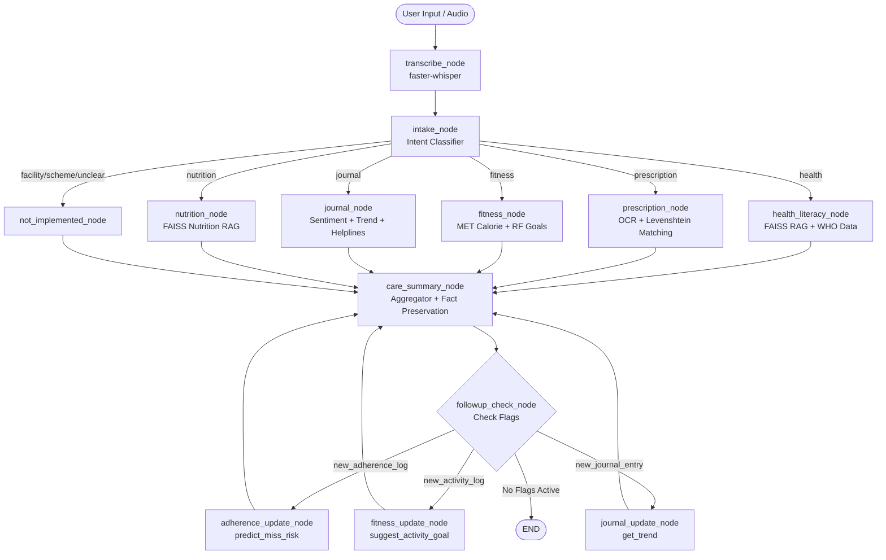

# MediPath — Multi-Agent Health, Nutrition & Wellness Assistant

[](https://www.python.org/)
[](https://github.com/langchain-ai/langgraph)
[]()
[]()

> **MediPath** is an accessible, multilingual, and voice-enabled multi-agent health, nutrition, and wellness assistant powered by Python, LangChain, and LangGraph. It helps users access, understand, and act on public health resources, adherence schedules, and wellness habits without diagnosing or providing clinical judgments.

---

## 📌 Project Overview & Philosophy

MediPath is designed from the ground up with a **safety-first, non-diagnostic philosophy**:
- **Non-Diagnostic Grounding**: Answers to health queries are strictly grounded in verified health corpora (e.g., WHO guidelines) with full source citations. The system never makes clinical diagnoses or prescribes medical treatments.
- **Supportive Mental Health**: Mood and sentiment analysis uses non-clinical, empathetic language and always provides professional helpline resources.
- **Closed-Loop Intelligence**: When new logs occur (adherence, fitness activities, journal entries), the system leverages conditional graph loops to recalculate risk scores and adaptive goals without re-executing initial intake classification.
- **Multimodal & Voice-Enabled**: Supports audio input via Whisper transcription, OCR for prescription images, and computer vision for food classification.

---

## 🏗️ System Architecture & Workflow

The orchestration engine is built using **LangGraph** with dynamic followup routing:



---

## 🚀 Current Status & Implemented Components

### ✅ Complete & Tested Components

| Component | Module | Status | Highlights / Key Metrics |
| :--- | :--- | :---: | :--- |
| **Voice Transcription** | `agents/voice_client.py` | ✅ Ready | `faster-whisper` (small model), automatic language detection |
| **LLM Orchestration** | `agents/llm_client.py` | ✅ Ready | LangChain Groq client (`llama-3.3-70b-versatile`) |
| **Intent Classification** | `agents/intake.py` | ✅ Tested | 8 categories + unclear, regex/keyword + file hints, **100% test accuracy** |
| **Health Literacy RAG** | `agents/health_rag.py` | ✅ Tested | FAISS index (140 chunks from WHO data), `all-MiniLM-L6-v2`, cited & grounded |
| **Prescription OCR** | `agents/prescription_ocr.py` | ✅ Tested | OpenCV preprocessing, Tesseract OCR, Levenshtein fuzzy match on 400+ drugs, dosage/freq regex |
| **Reminder System** | `agents/reminder.py` | ✅ Ready | Auto/manual confirmation threshold (0.75), 4-slot fixed daily schedules |
| **Adherence ML Model** | `agents/adherence_model.py` | ✅ Tested | Random Forest (100 trees), 8 engineered features, **96.8% recall**, **0.962 ROC AUC** |
| **Mental Health Journal** | `agents/journal.py` | ✅ Tested | Multilingual sentiment (-1.0 to +1.0), 14-day trend, non-diagnostic, 8 verified helplines |
| **Nutrition RAG** | `agents/nutrition_rag.py` | ✅ Ready | Vector search on nutrition guidelines, citations, non-prescriptive advice |
| **Food Recognition** | `agents/food_recognition.py` | ✅ Built | ResNet-18 transfer learning, frozen early layers, 60% confidence threshold |
| **Fitness Tracking** | `agents/fitness.py` | ✅ Tested | Deterministic MET calorie estimation + ML adaptive activity recommendations |
| **Care Summary** | `agents/care_summary.py` | ✅ Tested | Preserves factual data verbatim (doses, risk %), LLM narrative smoothing & translation |
| **Followup Loop Engine** | `agents/followup.py`<br/>`agents/graph_with_followup.py` | ✅ Tested | Dynamic flag management, conditional loopback, **7/7 unit & integration tests passing** |
| **Database Schema** | `db/schema.py` | ✅ Ready | SQLite with 4 tables: `prescriptions`, `medication_schedule`, `adherence_logs`, `journal_entries` |

---

### ⏳ In Progress & Upcoming Work

1. **Nearby Facility Finder (`agents/facility_finder.py`)**:
   - OpenStreetMap Overpass API queries for hospitals, clinics, and pharmacies within a configurable radius.
   - SQLite cache (`facility_cache`) with 7-day TTL to minimize external API rate-limiting.
2. **Government Health Scheme Advisor (`agents/scheme_eligibility.py`)**:
   - PDF criteria extraction (`data/prep_scheme_criteria.py`) from schemes like Ayushman Bharat (PM-JAY).
   - Structured JSON criteria (`data/processed/scheme_criteria.json`) and rule-based evaluation against user profiles.
3. **End-to-End User Interface (`ui/`)**:
   - Interactive user-facing frontend for voice interaction, image uploads, schedule reviews, and care summaries.

---

## 🔬 Machine Learning & RAG Details

### 1. Adherence Prediction Model
- **Algorithm**: Random Forest Classifier (100 trees, balanced class weights).
- **Dataset**: Synthetic adherence dataset (`data/processed/adherence_logs.csv`) with 7,500 records across 52 simulated users and 5 distinct behavioral personas.
- **Engineered Features**:
  1. `time_of_day_encoded` (Morning, Afternoon, Evening)
  2. `day_of_week` (0 to 6)
  3. `is_weekend` (Binary)
  4. `trailing_7day_miss_count`
  5. `trailing_14day_miss_count`
  6. `current_streak_length` (Positive for adherence, negative for missed doses)
  7. `user_overall_adherence` (Historical ratio)
  8. `dose_number_in_day` (Sequence index)
- **Metrics**: **96.8% recall** on missed doses, **72.0% precision**, **0.962 ROC AUC**.

### 2. Health & Nutrition FAISS Indices
- **Embeddings**: `sentence-transformers/all-MiniLM-L6-v2` (384-dimensional).
- **Search Metric**: L2 Euclidean distance with relevance ranking.
- **Guardrails**: Prompt-enforced source citations; refusal to offer speculative diagnoses or self-treatment regimens.

### 3. Food Recognition CNN
- **Architecture**: Fine-tuned ResNet-18 with frozen layer1–layer3 blocks.
- **Inference Strategy**: Top-1 softmax prediction with a 60% confidence threshold; low-confidence classifications trigger user confirmation prompts.

---

## 🗄️ Database Architecture

The SQLite database (`db/mediplus.db`) implements the following core schemas:

- `prescriptions`: Stores OCR-extracted metadata, fuzzy match candidate, Levenshtein distance, confidence score, status (`pending`, `confirmed`, `archived`), and dosage details.
- `medication_schedule`: Maps prescriptions to reminder timestamps (e.g., `08:00`, `14:00`, `20:00`) and active status flags.
- `adherence_logs`: Tracks user adherence events (`taken`, `missed`, `snoozed`, `skipped`) along with delay minutes.
- `journal_entries`: Stores journal content, compound sentiment score (-1.0 to +1.0), sentiment label, and timestamps.
- *(Upcoming)* `facility_cache`: Geo-hashed region key, JSON results, and cache timestamp with 7-day invalidation.

---

## 🧪 Testing & Verification

The test suite validates both isolated agent behavior and end-to-end graph execution:

```bash
# Run all tests via pytest
pytest tests/ -v

# Run the dynamic followup loop integration test
python tests/test_followup_loop.py

# Run intent classification test suite (10 test cases)
python tests/test_intake.py

# Run prescription OCR unit tests & sample evaluation
python tests/test_prescription_ocr.py

# Run graph routing test
python tests/test_graph_routing.py
```

### Confirmed Integration Results
```
[GRAPH] Generating care summary for branches: ['prescription_node']
[GRAPH] Followup flags detected: ['new_adherence_log']
[GRAPH] Running adherence update (predict_miss_risk)...
[GRAPH] Adherence risk updated: 30.00%
[GRAPH] No followup flags. Proceeding to END.
PASS  Integration test: graph loops back and updates summary
PASS  Sanity: no loop when no flags
ALL INTEGRATION TESTS PASSED
```

---

## 📁 Repository Structure

```
mediplus/
├── agents/                       # Specialized AI & ML Agents
│   ├── adherence_model.py        # Random Forest missed dose risk prediction
│   ├── care_summary.py           # Unified multi-agent care summary aggregator
│   ├── fitness.py                # MET calorie calculation & adaptive fitness goals
│   ├── followup.py               # Graph followup flag managers
│   ├── food_recognition.py       # ResNet-18 food image classifier
│   ├── graph.py                  # Base LangGraph workflow
│   ├── graph_with_followup.py    # Cyclic LangGraph workflow with followup loops
│   ├── health_rag.py             # FAISS RAG over WHO health data
│   ├── intake.py                 # Keyword & regex intent classification
│   ├── journal.py                # Mental health sentiment analysis & helpline lookup
│   ├── llm_client.py             # Groq ChatGroq LLM client wrapper
│   ├── nutrition_rag.py          # Nutrition guidance FAISS RAG
│   ├── prescription_ocr.py       # Tesseract OCR & Levenshtein drug matching
│   ├── reminder.py               # Prescription confirmation & reminder generator
│   └── voice_client.py           # faster-whisper speech-to-text
├── data/
│   ├── met_table.csv             # Metabolic Equivalent of Task reference table
│   ├── prep_health_corpus.py     # Health PDF chunking & vector indexing script
│   ├── processed/                # Preprocessed corpora, logs & synthetic datasets
│   ├── raw/                      # Raw input documents and image datasets
│   ├── reference/
│   │   └── drug_names.txt        # 400+ reference drug dictionary for fuzzy matching
│   ├── samples/                  # Sample images (prescriptions, food)
│   └── synthetic_adherence_generator.py # 5-persona adherence data simulator
├── db/
│   ├── mediplus.db               # SQLite operational database
│   └── schema.py                 # SQLite schema definitions & index initializers
├── models/                       # Serialized machine learning models
│   ├── adherence_model.pkl       # Trained adherence Random Forest model
│   ├── adherence_scaler.pkl      # Adherence feature scaler
│   ├── fitness_scaler.pkl        # Fitness feature scaler
│   ├── fitness_trend_model.pkl   # Fitness activity trend model
│   ├── food_classifier.pt        # Fine-tuned ResNet-18 PyTorch weights
│   └── health_faiss/             # Serialized FAISS health vector index
├── tests/                        # Automated unit & integration test suites
│   ├── test_followup_loop.py     # Graph cyclic loop tests
│   ├── test_graph.py             # Graph execution tests
│   ├── test_graph_routing.py     # Intent routing verification
│   ├── test_intake.py            # Intent classifier tests (100% pass)
│   ├── test_llm.py               # Groq LLM client tests
│   ├── test_prescription_ocr.py  # OCR & fuzzy match unit tests
│   └── test_voice.py             # Audio transcription tests
├── ui/                           # User interface directory (upcoming)
├── .env.example                  # Environment variable template
├── requirements.txt              # Project dependencies
├── README.md                     # Project overview and current status
└── SRS.md                        # Software Requirements Specification
```

---

## 🛠️ Setup & Installation

### 1. Prerequisites
- Python 3.10 or higher
- [Tesseract OCR](https://github.com/tesseract-ocr/tesseract) installed and added to your system PATH
- Groq API Key

### 2. Installation
```bash
# Clone the repository
git clone https://github.com/Manojn476/MediPath.git
cd MediPath

# Create and activate virtual environment
python -m venv .venv
# Windows:
.venv\Scripts\activate
# Linux/macOS:
source .venv/bin/activate

# Install dependencies
pip install -r requirements.txt
```

### 3. Environment Configuration
Copy `.env.example` to `.env` and supply your credentials:
```env
GROQ_API_KEY=your_groq_api_key_here
```

### 4. Database Setup
Initialize the database tables and indexes:
```bash
python db/schema.py
```

---

## 📖 Specifications & Documentation

For a detailed technical requirements document, architectural breakdown, data dictionary, and feature roadmap, please refer to [SRS.md](SRS.md).
